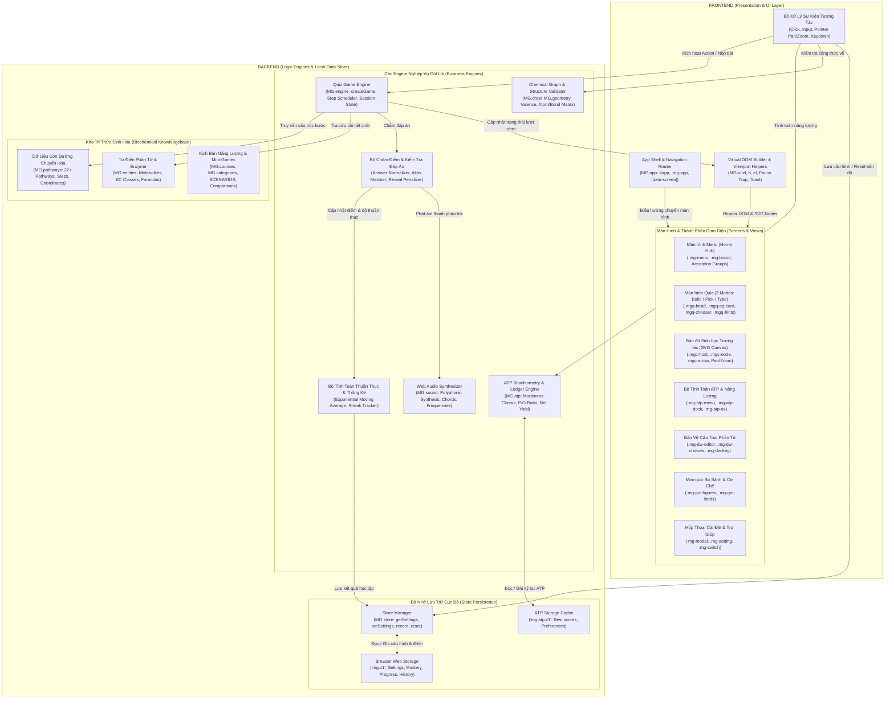
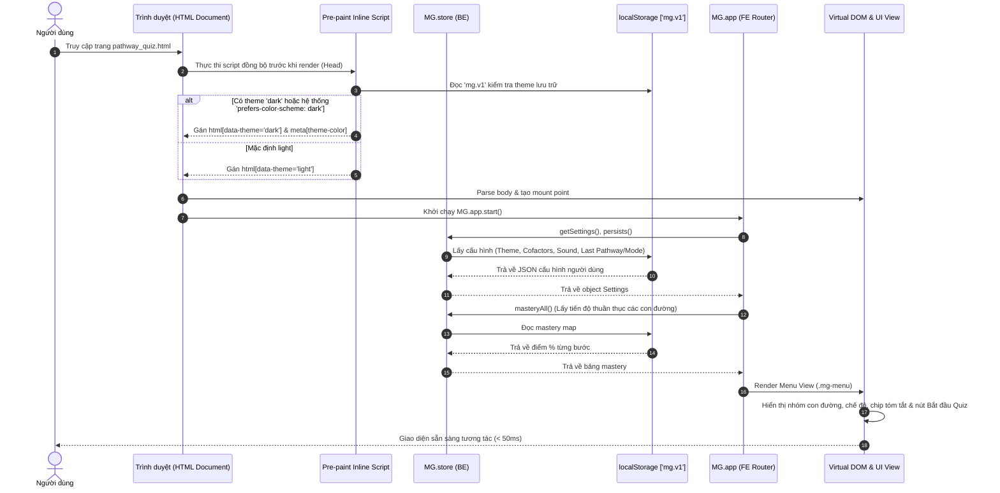
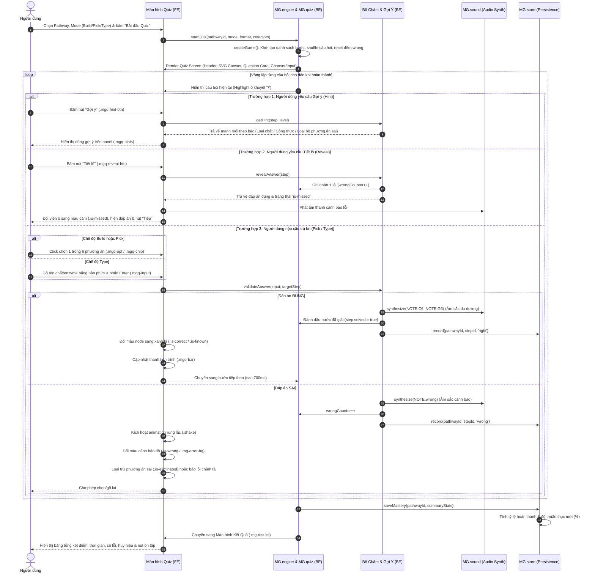
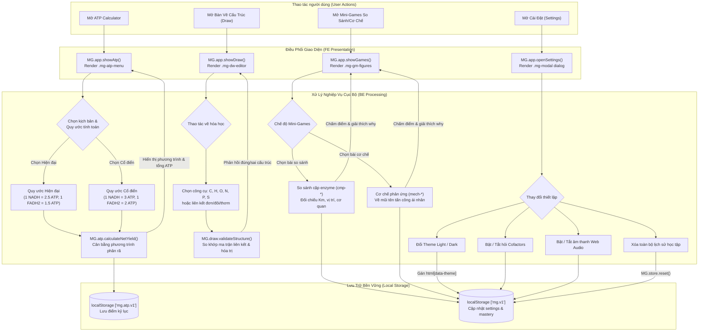
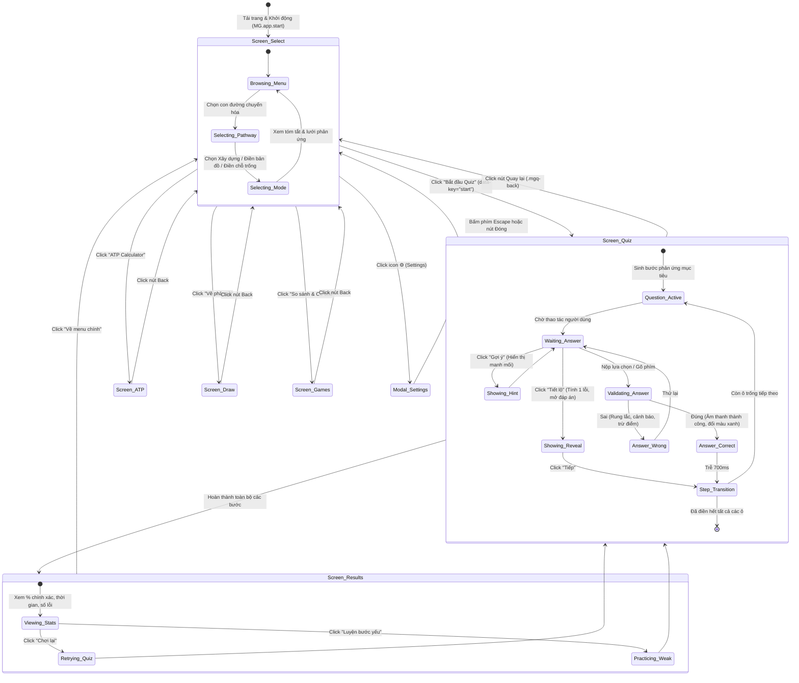

# Sơ Đồ Luồng Thao Tác Hệ Thống (FE & BE Architecture Flow)
### Biochemical Pathways Game (`pathway_quiz.html`)

Tài liệu này mô tả chi tiết toàn bộ kiến trúc và luồng thao tác giữa **Frontend (Giao diện người dùng / Presentation Layer)** và **Backend (Client-Side Business Logic, Engine tính toán & Data Persistence Layer)** của ứng dụng Single Page Application (SPA) thuần HTML5/CSS3/Vanilla JS.

---

## 1. Sơ Đồ Kiến Trúc Tổng Quan (System Architecture)

Dù là ứng dụng Zero-Dependency không phụ thuộc máy chủ web động, hệ thống phân tách nghiêm ngặt giữa tầng **Presentation (FE)** và tầng **Logic & Dữ Liệu (Client-Side BE)**.

---

## 2. Luồng Khởi Động & Nạp Trạng Thái (Bootstrap & Hydration Flow)

Sơ đồ trình tự quá trình tải trang ban đầu, đọc cấu hình từ `localStorage` và hiển thị màn hình chính không gây chớp nháy giao diện (FOUC).

---

## 3. Luồng Chơi Quiz Cốt Lõi (Core Quiz Gameplay Loop)

Chi tiết tương tác 3 chế độ (**Xây dựng / Điền vào bản đồ / Điền vào chỗ trống**), xử lý logic Gợi ý (Hint), Tiết lộ (Reveal) và Chấm đáp án.

---

## 4. Luồng Nghiệp Vụ Các Tiện Ích Phụ (ATP Calculator, Drawer & Comparisons)

---

## 5. Máy Trạng Thái Của Ứng Dụng (Application State Machine)

Sơ đồ trạng thái mô tả vòng đời của màn hình SPA và các chuyển dịch trạng thái (`data-screen` & `data-mode`).

---

## 6. Hợp Đồng Trao Đổi Dữ Liệu FE ↔ BE (Interface Contract)

| Tên Dịch Vụ / Module BE | Đầu Vào từ FE (Parameters) | Xử Lý Nghiệp Vụ (BE Responsibility) | Kết Quả Trả Về cho FE (Output / UI Effects) |
| :--- | :--- | :--- | :--- |
| `MG.app.startQuiz()` | `pathwayId`, `mode`, `format`, `cofactors` | Lấy dữ liệu phản ứng từ `MG.pathways`, lập lịch thứ tự bước, khởi tạo trạng thái game. | Kích hoạt `data-screen="play"`, mount bản đồ SVG và thanh câu hỏi. |
| `MG.engine.createGame()` | `steps`, `excluded`, `cofactors` | Lọc các bước bị loại trừ, tính toán số ô khuyết, gắn cờ cho từng chất. | Đối tượng phiên chơi (`game instance`) kèm các hàm điều khiển `step()`, `check()`, `reveal()`. |
| `MG.quiz.mount()` | `container`, `game`, `pathway` | Tạo Virtual DOM cho thẻ câu hỏi, lưới ô chọn, lắng nghe bàn phím và con trỏ. | DOM nodes được mount vào `#app`, khởi động timer và thanh tiến trình. |
| `MG.store.record()` | `pathwayId`, `stepId`, `'right'\|'wrong'` | Cập nhật bộ đếm thành công/thất bại, tính toán lại tỷ lệ thuần thục (Mastery %). | Lưu trữ trực tiếp vào `localStorage['mg.v1']`; cập nhật badge % trên thẻ menu. |
| `MG.store.setSettings()`| `{ theme, sound, cofactors, ... }` | Ghi đè thuộc tính cấu hình, đảm bảo tính toàn vẹn schema JSON. | Áp dụng tức thì biến CSS `[data-theme]`, cập nhật nhãn nút công tắc. |
| `MG.sound.play()` | `frequency`, `duration`, `chord` | Khởi tạo AudioContext, tổng hợp sóng âm dạng sin, làm mượt âm vực với bộ lọc low-pass. | Phát âm thanh phản hồi ra loa ngoài không làm nghẽn UI thread. |
| `MG.atp.calculate()` | `scenario`, `convention`, `shuttle` | Hạch toán số mol ATP từ quá trình đường phân, oxy hóa pyruvate, chu trình TCA và chuỗi chuyền điện tử. | Trả về tổng ATP thực nhận và công thức toán học phân rã từng bước. |
| `MG.chart.buildSvg()` | `pathway`, `mode`, `viewBox` | Tính toán tọa độ vector, đường bao màng sinh học, định tuyến mũi tên phản ứng và gắn chip cofactor. | Cây thẻ `<svg>` nhúng vào `.mgc-host`, kích hoạt tính năng kéo trượt (Pan) và phóng to (Zoom). |

---

*Tài liệu này là đặc tả chuẩn hóa kiến trúc luồng dữ liệu cho toàn bộ dự án Biochemical Pathways Game.*
