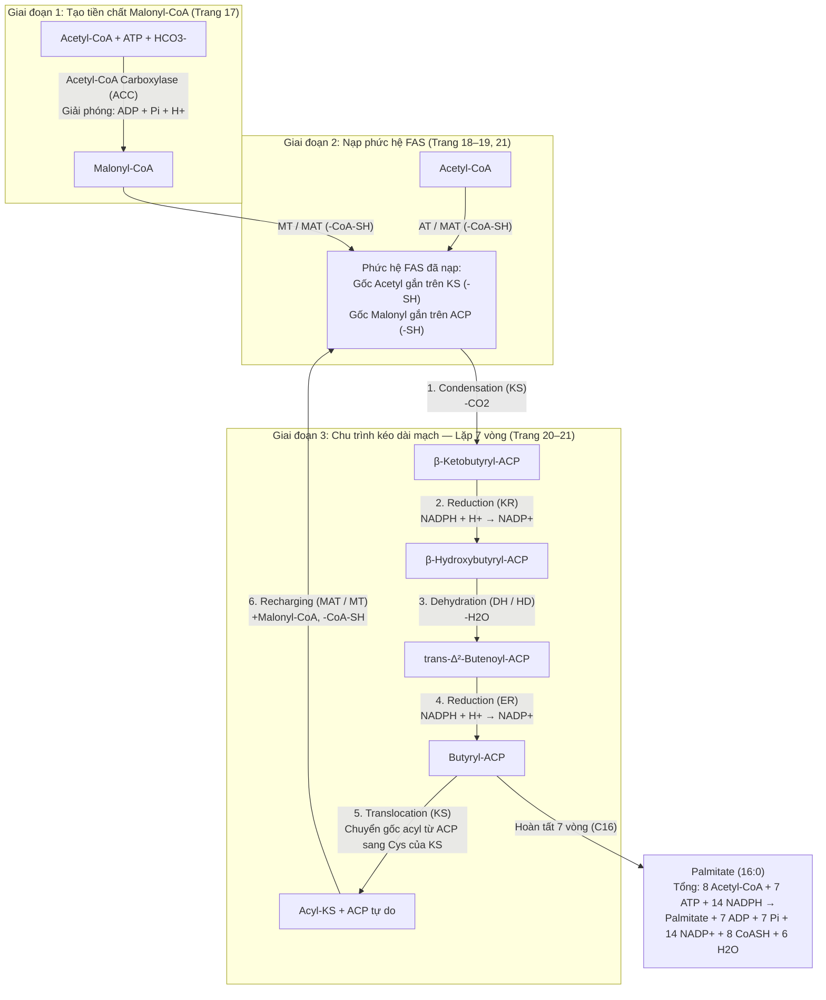
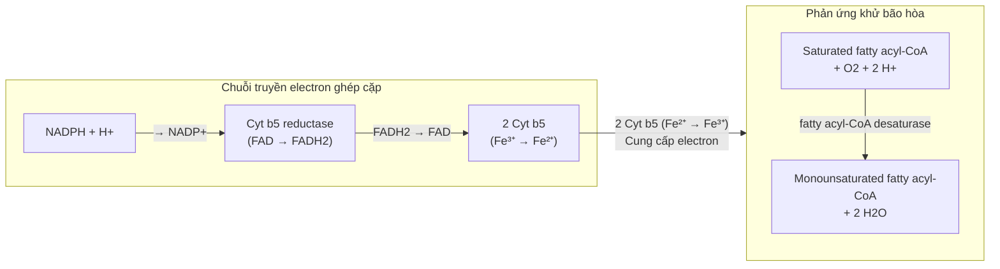
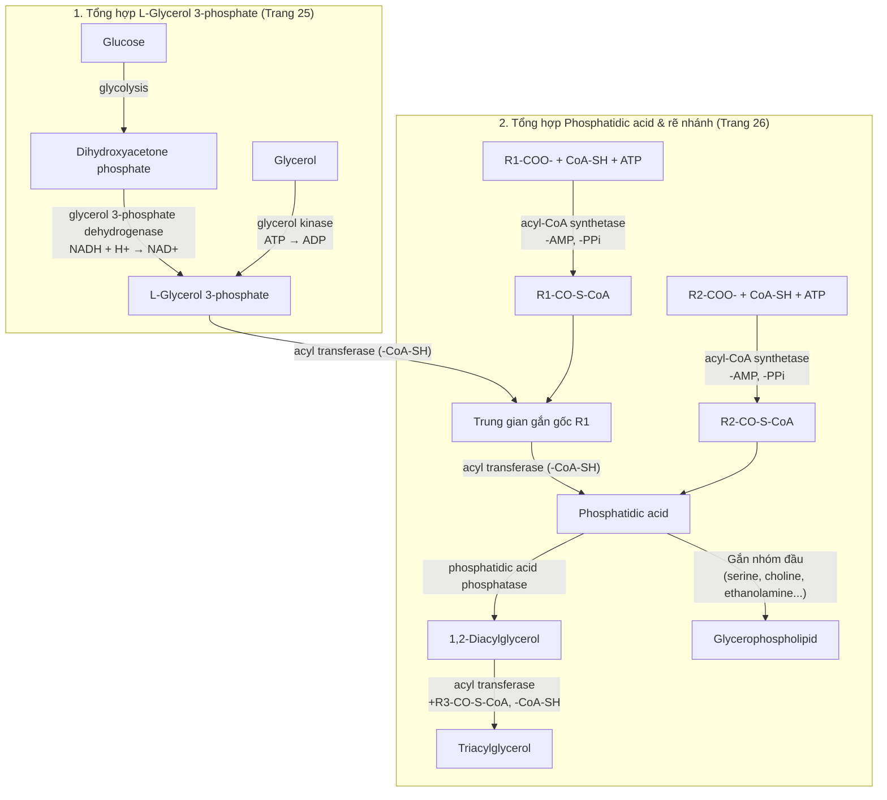
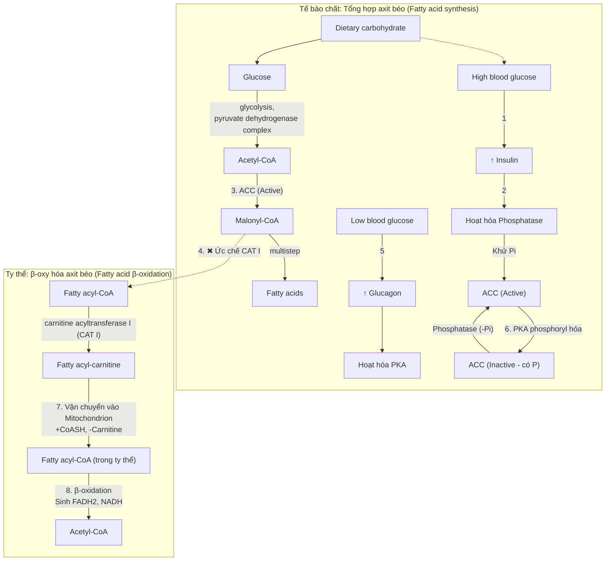
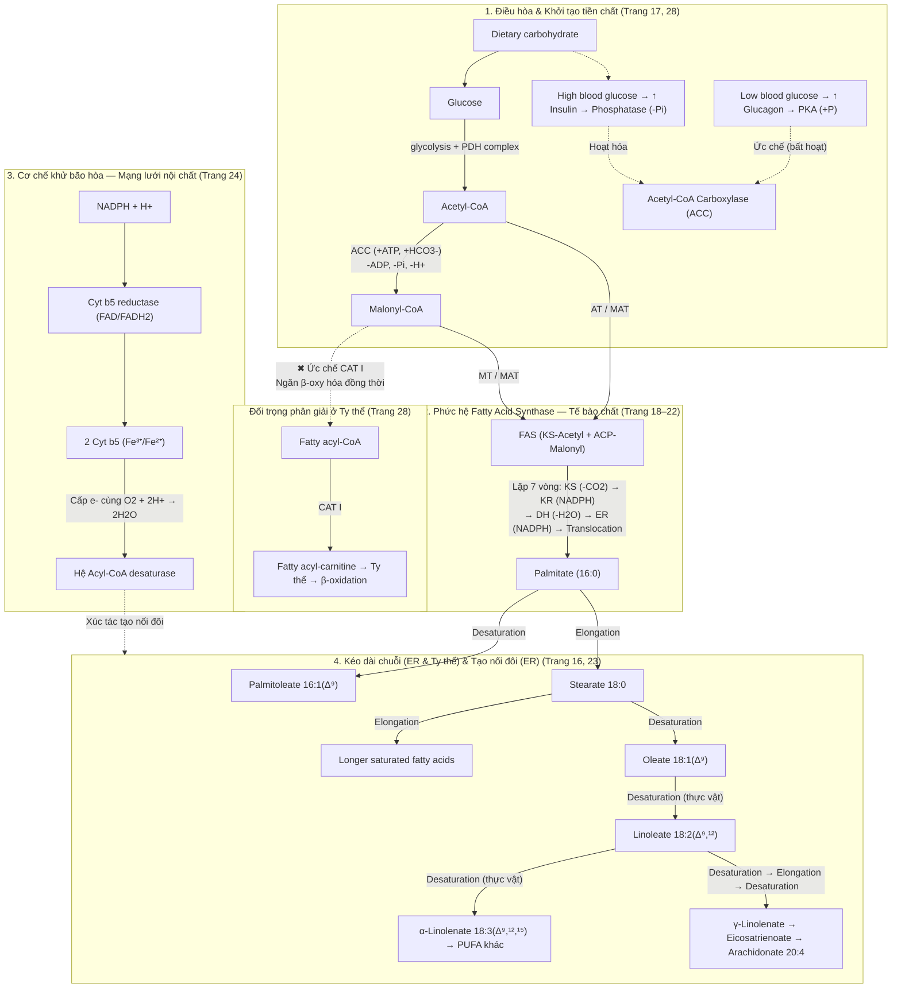
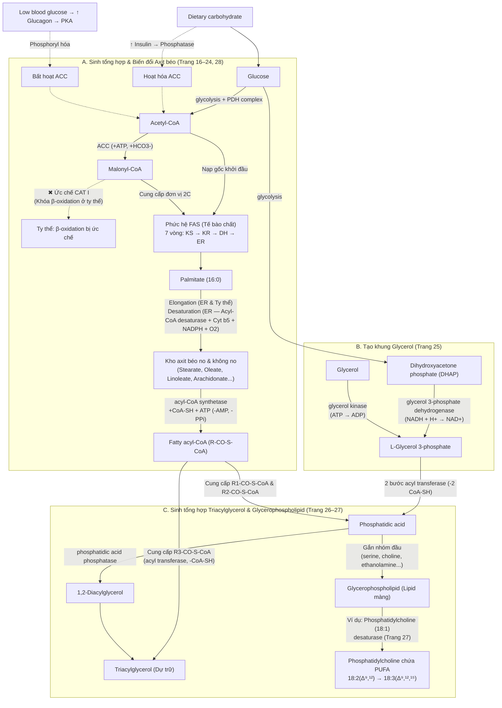

# Sơ đồ Mermaid: Các Chu Trình Sinh Tổng Hợp Lipid (Chương 11 — Từ Trang 15)

Tài liệu tổng hợp các sơ đồ Mermaid bám sát nội dung **Chương 11: Trao đổi Lipid** (từ trang 15 đến trang 28), gồm **5 sơ đồ chi tiết từng chu trình** và **2 sơ đồ tổng hợp** liên kết các con đường có quan hệ trực tiếp với nhau.

---

## Phần I. Các sơ đồ chi tiết từng chu trình

### 1. Tổng hợp Malonyl-CoA & Chu trình tổng hợp Palmitate (Trang 16–22)

*(Xảy ra ở tế bào chất, xúc tác bởi Acetyl-CoA Carboxylase và phức hệ Fatty Acid Synthase — FAS)*

### 2. Tổng hợp các axit béo no và không no khác (Trang 16, 23 & 27)

*(Kéo dài chuỗi xảy ra ở mạng lưới nội chất & ty thể; tạo nối đôi xảy ra ở mạng lưới nội chất)*

```mermaid
flowchart TD
    subgraph Main ["Kéo dài chuỗi & khử bão hòa từ Palmitate (Trang 23)"]
        P["Palmitate 16:0"] -->|"desaturation"| Po["Palmitoleate 16:1(Δ⁹)"]
        P -->|"elongation"| S["Stearate 18:0"]
        S -->|"elongation"| LSF["Longer saturated fatty acids"]
        S -->|"desaturation"| O["Oleate 18:1(Δ⁹)"]
        O -->|"desaturation<br/>(chỉ ở thực vật)"| Lin["Linoleate 18:2(Δ⁹,¹²)"]
        Lin -->|"desaturation<br/>(chỉ ở thực vật)"| aLin["α-Linolenate 18:3(Δ⁹,¹²,¹⁵)"]
        aLin --> PUFA["Other polyunsaturated fatty acids"]
        Lin -->|"desaturation"| gLin["γ-Linolenate 18:3(Δ⁶,⁹,¹²)"]
        gLin -->|"elongation"| Eic["Eicosatrienoate 20:3(Δ⁸,¹¹,¹⁴)"]
        Eic -->|"desaturation"| Ara["Arachidonate 20:4(Δ⁵,⁸,¹¹,¹⁴)"]
    end

    subgraph PC ["Tạo axit béo nhiều nối đôi ngay trong lipid màng (Trang 27)"]
        PC1["Phosphatidylcholine<br/>chứa Oleate 18:1(Δ⁹)"] -->|"desaturase"| PC2["Phosphatidylcholine<br/>chứa Linoleate 18:2(Δ⁹,¹²)"]
        PC2 -->|"desaturase"| PC3["Phosphatidylcholine<br/>chứa Linolenate 18:3(Δ⁹,¹²,¹⁵)"]
    end
```

### 3. Cơ chế tạo nối đôi bởi hệ Acyl-CoA desaturase (Trang 24)

### 4. Sinh tổng hợp Triacylglycerol & Glycerophospholipid (Trang 25–26)

### 5. Điều hòa trao đổi axit béo thông qua ACC và CAT I (Trang 28)

---

## Phần II. Các sơ đồ tổng hợp (Gộp các chu trình liên quan)

### A. Sơ đồ gộp: Điều hòa, Tổng hợp & Biến đổi Axit béo (Gộp Sơ đồ 1 + 2 + 3 + 5)

Sơ đồ này liên kết trục chuyển hóa axit béo từ nguồn carbohydrate/glucose, qua điểm kiểm soát ACC–CAT I, vào phức hệ FAS tạo Palmitate, rồi tiếp tục kéo dài mạch và khử bão hòa nhờ hệ Acyl-CoA desaturase.

### B. Bản đồ tổng thể Sinh tổng hợp Lipid (Gộp toàn bộ Sơ đồ 1–5)

Sơ đồ toàn cảnh kết nối tất cả các chu trình từ trang 15 đến trang 28: **Glucose** vừa là nguồn tạo **Acetyl-CoA** (tổng hợp axit béo), vừa tạo **DHAP → L-Glycerol 3-phosphate** (khung glycerol); sau đó axit béo hoạt hóa (**Acyl-CoA**) ghép với khung glycerol tạo **Phosphatidic acid**, rẽ nhánh thành **Triacylglycerol** (dự trữ) và **Glycerophospholipid** (lipid màng, nơi diễn ra phản ứng khử bão hòa tiếp theo trên Phosphatidylcholine).

